# Nova Sound MES — Sistema de Manufactura y Control de Calidad

[](#propuesta-beta--experimental)
[](https://nodejs.org/)
[](https://www.typescriptlang.org/)
[](https://react.dev/)
[](https://vitejs.dev/)
[](https://neon.tech/)
[](https://vitest.dev/)
[](./Nova%20Sound%20–%20Registro%20de%20observaciones%20de%20revisi%C3%B3n.pdf)

> ### Propuesta Beta / Experimental (`beta/rediseno-ui-industrial`)
> Esta rama es una **propuesta visual y de experiencia de usuario (HMI Industrial)** construida sobre el backend y la base de datos ya auditados.  
> Se publica en una rama independiente de prueba **sin modificar `main`**, para que el equipo pueda evaluarla, compararla y decidir libremente si se adopta o se mantiene como referencia.

Sistema integral de **Ejecución de Manufactura (MES / SCADA Industrial)** desarrollado para la trazabilidad completa, control de calidad bajo protocolo **ISO-9001**, empaque por contenedores, despacho logístico y auditoría en tiempo real para líneas de producción de bocinas inteligentes Nova Sound.

---

## Capturas de Pantalla (Vista Previa Beta)

### Acceso y Centro de Telemetría
| Inicio de Sesión HMI / MES | Centro de Telemetría y Operaciones |
| :---: | :---: |
| 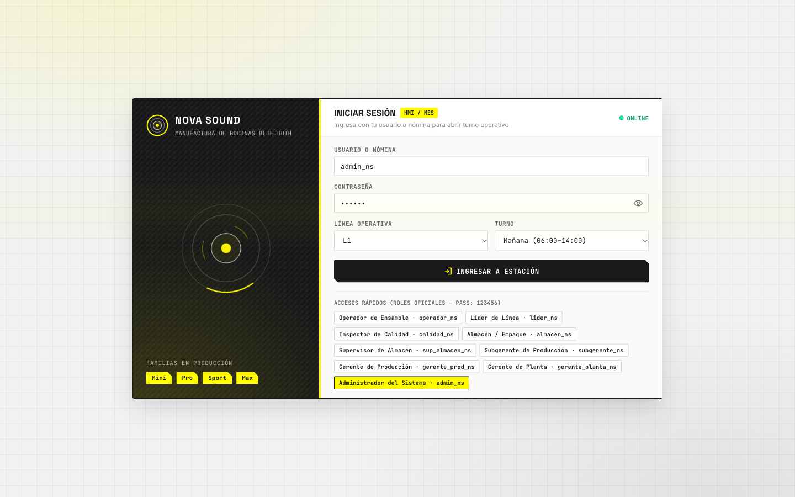 | 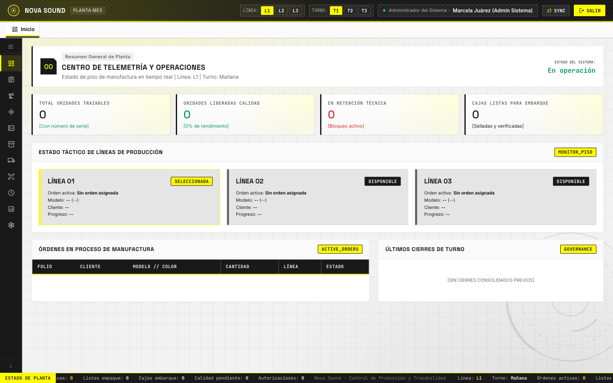 |

### Piso de Producción y Calidad
| 01 · Órdenes de Producción | 02 · Ensamble (Conteo) |
| :---: | :---: |
| 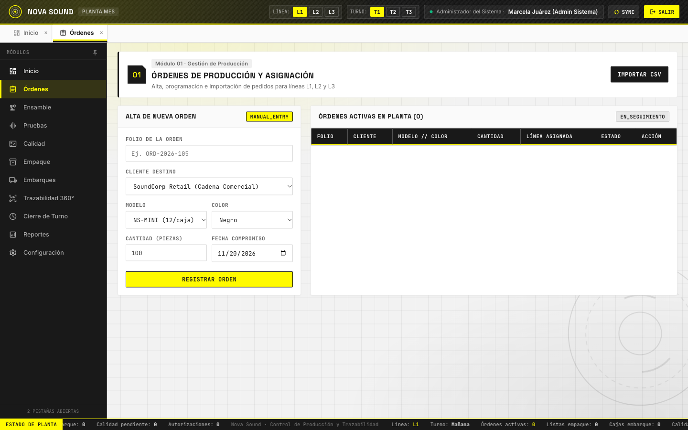 | 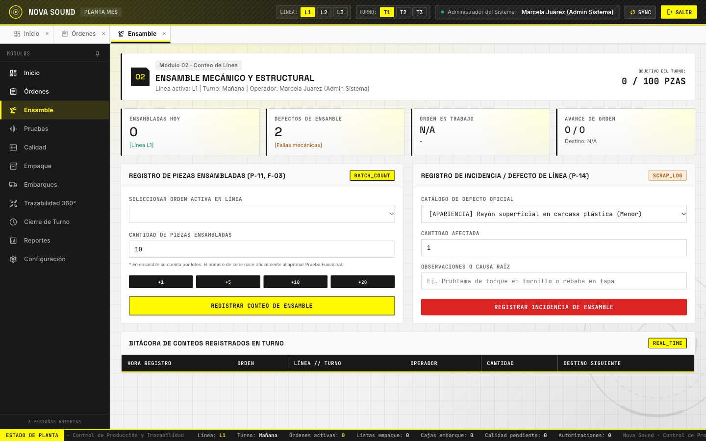 |

| 03 · Prueba Funcional (Nacimiento de Serie) | 04 · Inspección de Calidad |
| :---: | :---: |
| 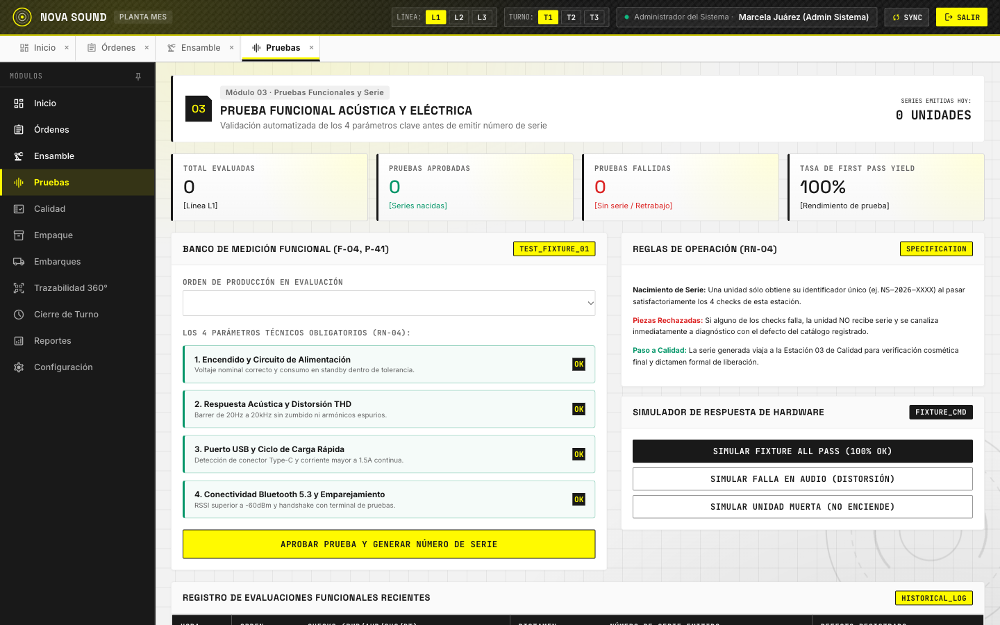 | 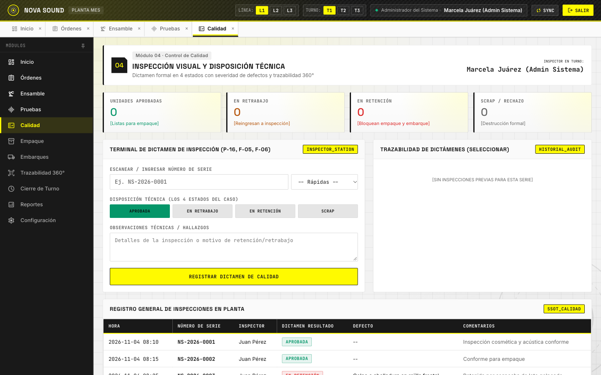 |

### Empaque, Logística y Trazabilidad
| 05 · Empaque y Cajas | 06 · Embarques y Despacho |
| :---: | :---: |
| 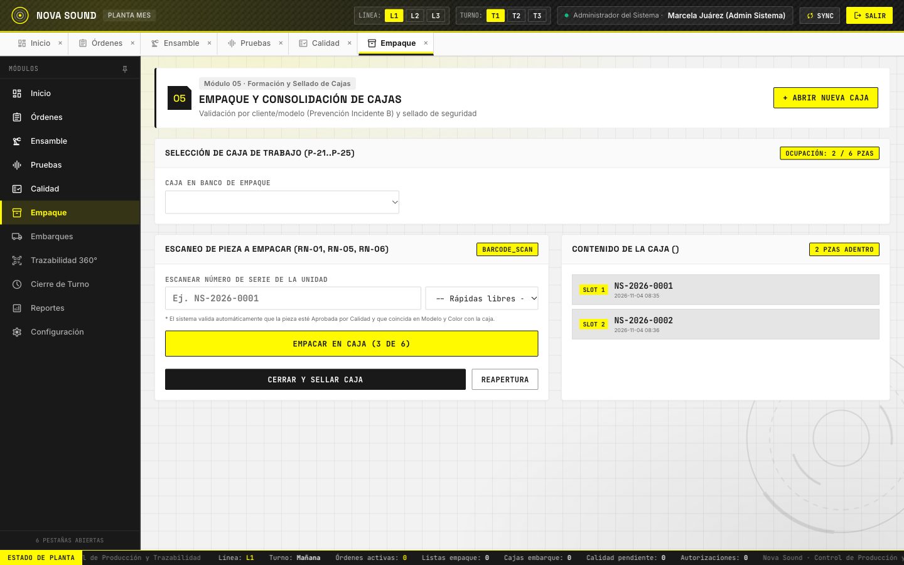 | 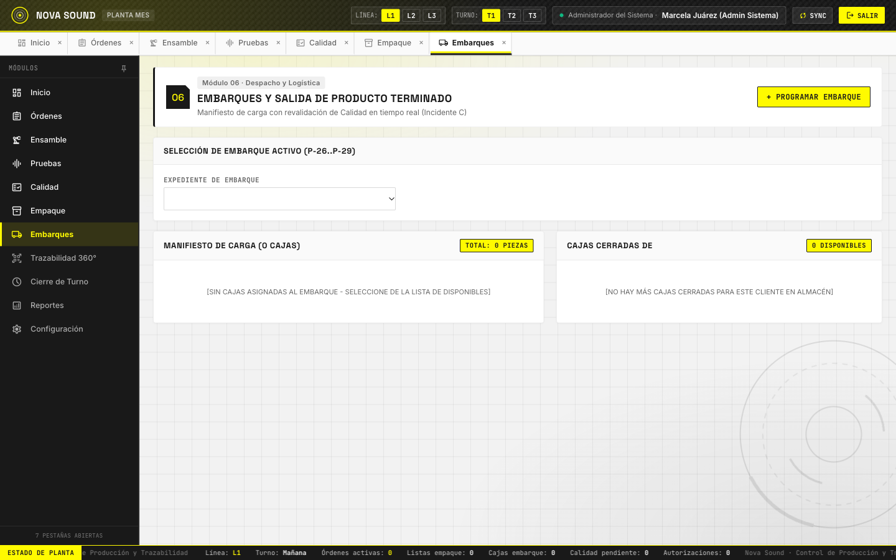 |

| 07 · Trazabilidad 360° por Serie | 08 · Cierres de Turno |
| :---: | :---: |
| 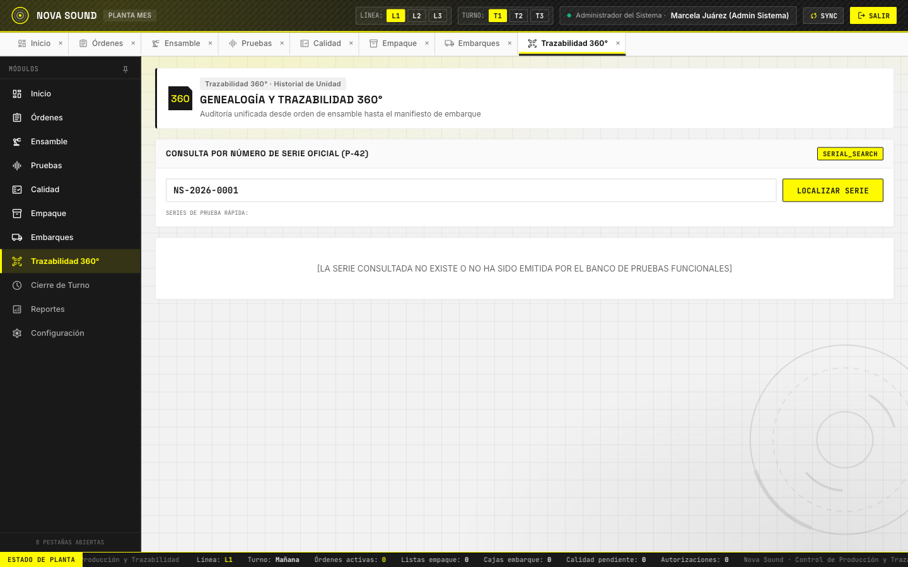 | 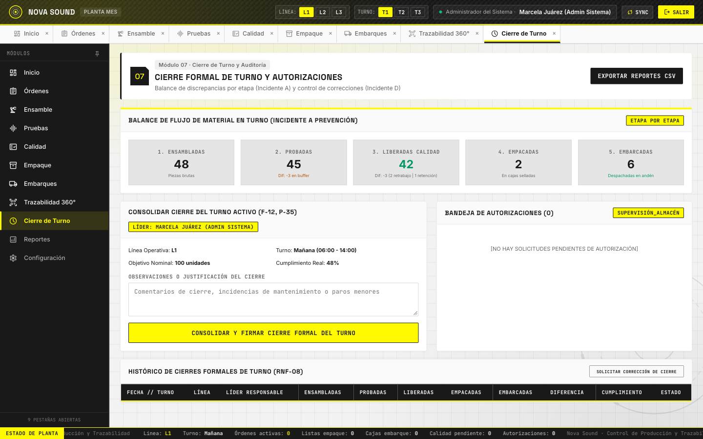 |

### Analítica y Administración
| 09 · Reportes e Indicadores | 10 · Configuración y Seguridad |
| :---: | :---: |
| 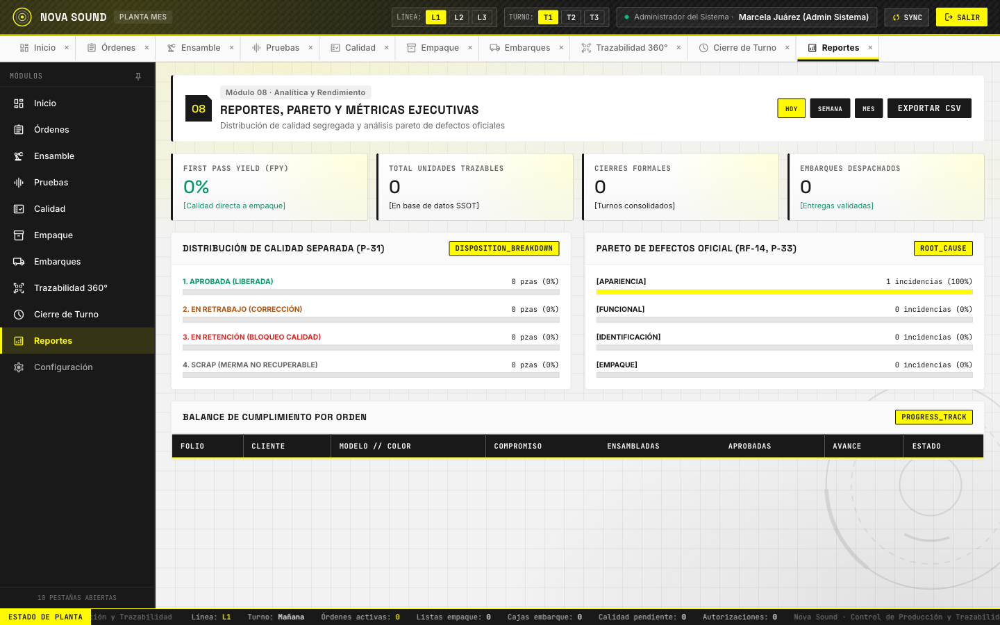 | 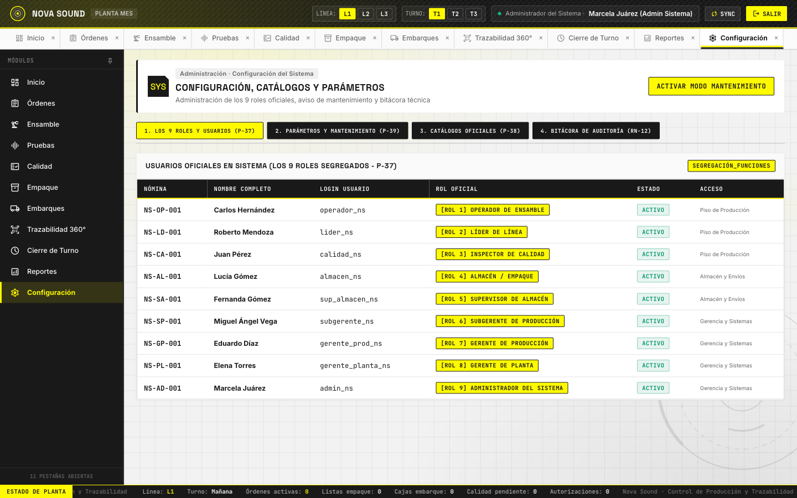 |

---

## Guía de Puesta al Día para el Equipo (Changelog de Auditoría)

> **Nota para colaboradores y compañeros del equipo:**  
> Este documento explica en detalle las modificaciones realizadas en este repositorio respecto a la versión inicial de GitHub ([`https://github.com/ZeftarimLothric/nova-sound-web/tree/main`](https://github.com/ZeftarimLothric/nova-sound-web/tree/main)).  
> Todos los cambios fueron implementados para resolver el 100% de los hallazgos y no conformidades señaladas en el documento docente de auditoría: **`Nova Sound – Registro de observaciones de revisión.pdf`**.  
>  
> **Para ver el desglose técnico archivo por archivo y el mapa de git diff, consulta:** [**`CHANGELOG_AUDITORIA.md`**](./CHANGELOG_AUDITORIA.md).

---

## Tabla de Contenidos
1. [Resumen Comparativo: Versión GitHub Original vs Versión Actual](#1-resumen-comparativo-versión-github-original-vs-versión-actual)
2. [Solución a los 4 Incidentes Críticos de Planta](#2-solución-a-los-4-incidentes-críticos-de-planta)
3. [Cambios en Base de Datos y Modelo Relacional (BD-01 a BD-20)](#3-cambios-en-base-de-datos-y-modelo-relacional-bd-01-a-bd-20)
4. [Cambios en el Backend (API REST y Lógica de Negocio)](#4-cambios-en-el-backend-api-rest-y-lógica-de-negocio)
5. [Cambios en el Frontend (HMI / Estaciones de Trabajo)](#5-cambios-en-el-frontend-hmi--estaciones-de-trabajo)
6. [Estructura Actualizada del Repositorio](#6-estructura-actualizada-del-repositorio)
7. [Guía de Instalación y Puesta en Marcha](#7-guía-de-instalación-y-puesta-en-marcha)
8. [Ejecución de Pruebas Automatizadas (Vitest)](#8-ejecución-de-pruebas-automatizadas-vitest)
9. [Catálogo Oficial de Credenciales y los 9 Roles](#9-catálogo-oficial-de-credenciales-y-los-9-roles)

---

## 1. Resumen Comparativo: Versión GitHub Original vs Versión Actual

| Área | Estado en GitHub (`main` inicial) | Estado Actual (Modificado tras Auditoría) | Observación / Regla Resuelta |
| :--- | :--- | :--- | :--- |
| **Nacimiento de Serie** | Ensamble escaneaba una serie inventada por pieza. | **Ensamble sólo cuenta piezas.** La serie oficial (`NS-2026-XXXX`) nace en **Prueba Funcional** al aprobar los 4 checks. | **F-03, F-04, RN-04, BD-08** |
| **Prueba Funcional** | No existía estación; 4 casillas estaban dentro de Calidad y venían pre-marcadas. | **Estación y servicios dedicados.** Si falla un check, se registra defecto de catálogo sin otorgar serie. | **F-04, P-17, P-18, P-41, BD-03** |
| **Módulo de Órdenes** | Inexistente. Las órdenes sólo se veían estáticas en reportes. | **Módulo completo de Órdenes:** Alta manual, importación CSV y asignación a líneas L1/L2/L3 con fecha y usuario. | **F-01, F-02, P-12, P-40** |
| **Formación de Cajas** | "Apertura de caja" sin cliente, modelo ni color. Sin cierre formal. | **Apertura pidiendo Cliente, Modelo y Color.** Capacidad oficial según modelo. Botones **Cerrar**, **Reapertura** y **Retirar unidad**. | **F-08, F-09, P-21, P-22, BD-01** |
| **Validación de Empaque** | Permitía meter cualquier pieza sin validar modelo ni color. | **Validación estricta:** Bloquea piezas no aprobadas y piezas de modelo/color diferente al de la caja. | **RN-01, RN-05, RN-06 (Incidente B)** |
| **Despacho de Embarques** | Confirmación ciega sin verificar el estado de las piezas dentro de las cajas. | **Revalidación en tiempo real:** Bloquea la confirmación de salida si alguna unidad está en estado "En retención" o "Scrap". | **F-10, F-11, P-29, RN-02 (Incidente C)** |
| **Trazabilidad de Serie** | Sin búsqueda rápida global de unidad. | **Módulo de Trazabilidad 360°:** Búsqueda por serie con genealogía completa (orden, línea, prueba, calidad, caja y embarque). | **P-42, RN-13, RF-25** |
| **Cierre de Turno** | Botón genérico "Consolidar turno" sin tabla ni diferencias por etapa. | **Cierre formal del Líder:** Matriz de balance por etapa para evitar piezas perdidas, bandeja de autorizaciones y exportación CSV. | **F-12, P-35, P-43, BD-12 (Incidente A y D)** |
| **Bandeja de Autorizaciones** | Inexistente; permisos solo en UI. | **Tabla y endpoints de autorizaciones (RN-09, RN-11, RN-14)** para reapertura de cajas y ajuste de turnos. | **BD-13, BD-14, RN-14** |
| **Roles de Usuario** | 5 roles genéricos sin permisos en BD. | **Los 9 roles oficiales del caso** con permisos granulares y middleware `requirePermission`. | **P-37, BD-14, RNF-01b** |
| **Aviso Mantenimiento** | Inexistente. | **Parámetro del sistema** (`SISTEMA_MODO_MANTENIMIENTO`) con aviso visible en terminales. | **P-39, BD-17, RNF-07** |

---

## 2. Solución a los 4 Incidentes Críticos de Planta

El documento de auditoría estableció que el sistema debía demostrar la prevención de los 4 incidentes reales ocurridos en la planta Nova Sound. Todos cuentan con pruebas automatizadas en `tests/incidentes.audit.test.ts`:

### Incidente A: 87 unidades "desaparecidas" en turno
* **Causa en versión inicial:** No se medía el inventario en proceso (WIP) entre etapas; si ensamble reportaba 100 y calidad liberaba 80, no se sabía dónde estaban las 20 restantes.
* **Solución implementada:** Se integró la **Matriz de Balance por Etapas**:
  $$\text{Diferencia WIP} = \text{Ensambladas} - \text{Probadas} - \text{Liberadas} - \text{Empacadas} - \text{Embarcadas}$$
  El reporte de cierre del turno desglosa exactamente cuántas piezas quedaron en cada buffer y levanta alertas si hay discrepancias no justificadas.

### Incidente B: Caja de NS-PRO Negro contaminada con 6 piezas NS-SPORT Azul
* **Causa en versión inicial:** La tabla `cajas` no guardaba cliente, modelo ni color; cualquier operador podía escanear cualquier serie en cualquier caja.
* **Solución implementada:** 
  1. La tabla `cajas` ahora almacena `id_cliente`, `id_modelo`, `id_color` y capacidad según modelo.
  2. El servicio `cajas.service.ts` valida en tiempo real:
     * Que la unidad coincida exactamente en `id_modelo`.
     * Que coincida en `id_color` (a menos que el cliente explícitamente permita mezcla en `clientes.permite_mezcla_colores`).
     * Que la unidad esté en estado **Aprobada** por Calidad.

### Incidente C: Unidades retenidas enviadas al cliente en un embarque
* **Causa en versión inicial:** Una unidad se empacaba cuando estaba aprobada, luego Calidad abría una investigación y la ponía "En retención", pero el módulo de Embarques no revalidaba el estado al salir el camión.
* **Solución implementada:** El endpoint `PATCH /api/embarques/:id/despachar` ejecuta una consulta transaccional que recorre todas las unidades contenidas en las cajas asignadas al embarque. Si tan solo **una unidad** tiene estado distinto a `Aprobada`, **la transacción se aborta con error HTTP 400 y mensaje explícito de bloqueo por calidad**.

### Incidente D: Cierre de turno tarde y ajustes no autorizados
* **Causa en versión inicial:** El cierre dependía de hojas de cálculo externas y las correcciones de piezas se hacían directamente en base de datos sin bitácora ni aprobación.
* **Solución implementada:** Creación de la entidad `cierres_turno` y el flujo de `solicitudes_autorizacion`. Si un líder necesita ajustar un número después de cerrado el turno, genera una solicitud que debe ser aprobada por el Gerente de Producción (RN-11).

---

## 3. Cambios en Base de Datos y Modelo Relacional (BD-01 a BD-20)

Los nuevos scripts se ubican en la carpeta [`database/`](./database/):

1. **`schema_completo_actualizado.sql` (Esquema SSOT en PostgreSQL):**
   * **`cajas`:** Agregadas columnas `id_cliente`, `id_modelo`, `id_color`, `id_usuario_cerro`, `id_embarque_asignado`.
   * **`detalle_caja`:** Historial de entrada, slots y retiro de piezas con fecha y motivo (BD-07).
   * **`prueba_funcional`:** Se desacopló la serie obligatoria. Ahora guarda las 4 validaciones booleanas y se vincula con la unidad únicamente si aprueba (BD-03, BD-04).
   * **`defectos_ensamble` y `defectos_funcionales`:** Ligados mediante llaves foráneas formales a `catalogo_defectos` (BD-05, BD-06).
   * **`cierres_turno`:** Nueva tabla para formalizar el corte de turno del Líder con métricas reales vs objetivo (BD-12).
   * **`solicitudes_autorizacion`:** Nueva tabla para gestionar reapertura de cajas y ajustes de cierres (BD-13).
   * **`permisos` y `rol_permisos`:** Matriz RBAC para los 9 roles oficiales (BD-14).
   * **`parametros_sistema`:** Soporte para tipos de dato y clave `SISTEMA_MODO_MANTENIMIENTO` (BD-17).
   * **`clientes`:** Columnas `permite_mezcla_colores`, `requiere_etiqueta`, `requisitos_empaque` (BD-18).
2. **`INSERTS_CATALOGOS_OFICIALES.sql`:**
   * Carga de los **9 roles oficiales** con descripciones ISO-9001.
   * Carga de **15 permisos granulares**.
   * Carga de usuarios de prueba para cada rol con contraseñas hasheadas en **bcrypt real** (contraseña: `123456`).
   * Catálogo unificado de defectos en las 4 categorías oficiales: *Apariencia*, *Funcional*, *Identificación* y *Empaque*.
   * Políticas de los 4 clientes base (`SoundCorp Retail`, `MegaAudio`, `TechBeat`, `ElectroMax`).
3. **`migracion_actualizacion.sql`:**
   * Script DDL idempotente que aplica `ALTER TABLE` y `CREATE TABLE IF NOT EXISTS` sobre bases de datos existentes en Neon sin perder información previa.

---

## 4. Cambios en el Backend (API REST y Lógica de Negocio)

La arquitectura del backend en [`nova-sound-ui-BACKEND/`](./nova-sound-ui-BACKEND/) se robusteció con servicios y repositorios desacoplados:

### Nuevos Controladores y Rutas (`src/routes/index.ts`)
* **`/api/ensamble`:**
  * `POST /conteo`: Registro de cantidad producida sin serie (F-03).
  * `POST /defecto`: Registro de scrap o falla mecánica con catálogo.
* **`/api/pruebas`:**
  * `POST /evaluar`: Evaluación de checks (Encendido, Audio, Carga, Bluetooth) y generación de serie `NS-2026-XXXX` al aprobar (F-04).
* **`/api/ordenes`:**
  * `GET /`: Listado de órdenes y avance.
  * `POST /`: Creación manual de orden.
  * `POST /importar`: Carga masiva de pedidos por CSV.
  * `PATCH /:id/asignar-linea`: Asignación a línea L1/L2/L3 con fecha y usuario.
* **`/api/cajas`:**
  * `POST /`: Apertura pidiendo cliente, modelo y color.
  * `POST /empacar-serie`: Empaque validando modelo, color y dictamen Aprobado (Incidente B).
  * `PATCH /:id/cerrar`: Sellado definitivo de la caja.
  * `POST /:id/retirar-unidad`: Retiro de pieza con motivo de auditoría.
* **`/api/embarques`:**
  * `POST /asignar-caja`: Asigna únicamente cajas cerradas del cliente del pedido.
  * `PATCH /:id/despachar`: Revalidación de calidad en tiempo real y salida de almacén (Incidente C).
* **`/api/turnos`:**
  * `GET /metricas`: Matriz de balance y cálculo de diferencias en piso (Incidente A).
  * `POST /cierre`: Consolidación formal del Líder de Línea.
  * `GET /cierres/exportar`: Descarga de reporte en formato CSV.
  * `PATCH /cierres/:id/corregir`: Corrección sujeta a autorización gerencial.
* **`/api/autorizaciones`:**
  * `GET /`, `POST /solicitar`, `PATCH /:id/resolver`: Bandeja de gobernanza para supervisores y gerentes.
* **`/api/health`:**
  * Retorna estado operativo o aviso si el modo mantenimiento está activado (RNF-07).

### Middleware de Seguridad (`src/middlewares/auth.middleware.ts`)
* Función `requirePermission(codigoPermiso)` que consulta la matriz `rol_permisos` en PostgreSQL y bloquea acciones no autorizadas con código HTTP 403 Forbidden.

---

## 5. Cambios en el Frontend (HMI / Estaciones de Trabajo)

En [`nova-sound-ui-FRONTEND/`](./nova-sound-ui-FRONTEND/) se sincronizaron las 11 estaciones operativas con el backend:

1. **`[00]` Telemetría:** Monitor de líneas L1, L2, L3, balance de piso y aviso de mantenimiento.
2. **`[01]` Órdenes de Producción:** Formulario de alta, importador CSV y asignador de líneas con usuario y fecha.
3. **`[02]` 1. Ensamble:** Selector dinámico de orden activa (modelo y color heredados), conteo por lotes sin serie y registro de defectos.
4. **`[03]` 2. Prueba Funcional:** Banco de pruebas acústico/eléctrico con los 4 checks. Emisión y bautizo de la serie `NS-2026-XXXX`.
5. **`[04]` 3. Calidad:** Inspección con los 4 estados oficiales (Aprobada, En retrabajo, En retención, Scrap), severidad y re-inspección tras retrabajo.
6. **`[05]` 4. Empaque:** Apertura de cajas por cliente/modelo/color, medidor de capacidad, botones Cerrar/Reabrir/Retirar y prevención del Incidente B.
7. **`[06]` 5. Embarques:** Manifiesto de remisión con chofer, placas, transportista oficial y bloqueo por Incidente C.
8. **`[360]` Trazabilidad 360°:** Consulta por número de serie con historial completo de movimientos.
9. **`[07]` Cierre & Autorizaciones:** Cierre formal del Líder, matriz de balance de piezas y bandeja de resolución de autorizaciones.
10. **`[08]` Reportes & Pareto:** Pareto de defectos en 4 categorías, retención segregada y exportador a CSV.
11. **`[SYS]` Configuración:** Gestión de los 9 roles, parámetros del sistema y bitácora de auditoría.

---

## 6. Estructura Actualizada del Repositorio

```text
nova_sound_web/
├── database/                                  # Scripts SQL y migraciones
│   ├── Tablas.sql                             # DDL base original
│   ├── schema_completo_actualizado.sql        # DDL completo con todas las correcciones
│   ├── migracion_actualizacion.sql            # Script para actualizar bases de datos existentes
│   ├── INSERTS_CATALOGOS_OFICIALES.sql        # Semillas oficiales (9 roles, permisos, defectos)
│   └── INSERTS_NOVA_SOUND.txt                 # Datos maestros iniciales
│
├── nova-sound-ui-BACKEND/                     # API REST (Node.js + Express + TypeScript)
│   ├── src/
│   │   ├── config/db.ts                       # Conexión a PostgreSQL (Neon / Local)
│   │   ├── controllers/                       # Controladores HTTP
│   │   │   ├── ensamble.controller.ts         # Conteo y defectos de línea
│   │   │   ├── pruebas.controller.ts          # Evaluación funcional y emisión de series
│   │   │   ├── operaciones.controller.ts      # Cajas, órdenes, embarques, turnos, autorizaciones
│   │   │   ├── unidades.controller.ts         # Trazabilidad y calidad
│   │   │   └── usuarios.controller.ts         # Login y usuarios
│   │   ├── services/                          # Lógica de negocio e ISO-9001
│   │   │   ├── ensamble.service.ts
│   │   │   ├── pruebas.service.ts
│   │   │   ├── cajas.service.ts
│   │   │   ├── embarques.service.ts
│   │   │   ├── cierres-turno.service.ts
│   │   │   └── autorizaciones.service.ts
│   │   ├── repositories/                      # Consultas SQL (Data Access Layer)
│   │   ├── middlewares/
│   │   │   └── auth.middleware.ts             # Control de acceso por permisos (RBAC)
│   │   ├── routes/index.ts                    # Enrutador central /api
│   │   └── server.ts                          # Entrada del servidor (puerto 4000)
│   ├── tests/                                 # Pruebas automatizadas (Vitest)
│   │   ├── incidentes.audit.test.ts           # Verificación de INC-A, INC-B, INC-C, INC-D
│   │   ├── pruebas_funcionales.test.ts        # Verificación del nacimiento de serie
│   │   └── integracion_completa_bd.test.ts    # Flujo end-to-end de base de datos
│   └── package.json
│
├── nova-sound-ui-FRONTEND/                    # HMI / MES Industrial (React 19 + TypeScript + Vite)
│   ├── src/
│   │   ├── Pages/Areas/                       # Las 11 estaciones de manufactura
│   │   ├── components/                        # Componentes de estación y Topbar
│   │   ├── context/PlantaContext.tsx          # Estado reactivo y conexión a la API
│   │   ├── types/database.ts                  # Interfaces sincronizadas con PostgreSQL
│   │   └── index.css                          # Sistema de diseño industrial
│   └── package.json
│
├── Nova Sound – Registro de observaciones de revisión.pdf # Documento de auditoría base
└── README.md                                  # Este documento
```

---

## 7. Guía de Instalación y Puesta en Marcha

### Requisitos Previos
* **Node.js** v18+ (recomendado Node.js v20+ LTS).
* **npm** v9+.
* Instancia de **PostgreSQL** en [Neon.tech](https://neon.tech/) o local.

### Paso 1: Configurar la Base de Datos
Ejecuta en tu base de datos PostgreSQL los scripts en este orden:
1. `database/schema_completo_actualizado.sql` (o `migracion_actualizacion.sql` si ya tenías tablas previas).
2. `database/INSERTS_CATALOGOS_OFICIALES.sql`.

### Paso 2: Iniciar el Backend
```bash
cd nova-sound-ui-BACKEND
npm install
cp .env.example .env
# Configura DATABASE_URL en tu archivo .env con tu cadena de conexión
npm run dev
```
El servidor arrancará en: `http://localhost:4000/api`

### Paso 3: Iniciar el Frontend
```bash
cd ../nova-sound-ui-FRONTEND
npm install
npm run dev
```
La interfaz estará lista en: `http://localhost:5173/`

---

## 8. Ejecución de Pruebas Automatizadas (Vitest)

Para verificar que todos los requerimientos y los 4 incidentes están 100% resueltos, ejecuta en la carpeta del backend:

```bash
cd nova-sound-ui-BACKEND
npm test
```

Salida esperada:
* `tests/incidentes.audit.test.ts`: Validación de prevención para Incidente A, B, C y D (**PASS**).
* `tests/pruebas_funcionales.test.ts`: Verificación de emisión de serie y rechazo de fallas (**PASS**).
* `tests/unidades.service.test.ts`: Flujo de calidad y estados (**PASS**).

---

## 9. Catálogo Oficial de Credenciales y los 9 Roles

Todos los usuarios oficiales están precargados con la contraseña: **`123456`**

| Nómina | Nombre Completo | Login | Rol Oficial (P-37) | Módulos con Acceso |
| :--- | :--- | :--- | :--- | :--- |
| `NS-OP-001` | Carlos Hernández | `operador_ns` | 1. Operador de Ensamble | Ensamble, Pruebas Funcionales |
| `NS-LD-001` | Roberto Mendoza | `lider_ns` | 2. Líder de Línea | Ensamble, Pruebas, Órdenes, Cierre de Turno |
| `NS-CA-001` | Juan Pérez | `calidad_ns` | 3. Inspector de Calidad | Calidad, Pruebas Funcionales, Trazabilidad |
| `NS-AL-001` | Lucía Gómez | `almacen_ns` | 4. Almacén / Empaque | Empaque, Embarques, Trazabilidad |
| `NS-SA-001` | Fernanda Gómez | `sup_almacen_ns` | 5. Supervisor de Almacén | Empaque, Embarques, Autorización de Reaperturas |
| `NS-SP-001` | Miguel Ángel Vega | `subgerente_ns` | 6. Subgerente de Producción | Órdenes, Balance de Planta, Asignación de Líneas |
| `NS-GP-001` | Eduardo Díaz | `gerente_prod_ns` | 7. Gerente de Producción | Órdenes, Cierres de Turno, Autorización de Ajustes |
| `NS-PL-001` | Elena Torres | `gerente_planta_ns` | 8. Gerente de Planta | Tableros Ejecutivos, Reportes, Embarques |
| `NS-AD-001` | Marcela Juárez | `admin_ns` | 9. Administrador del Sistema | Acceso Total, Parámetros, Modo Mantenimiento, DB |

---

*Proyecto desarrollado para la materia de Calidad y Pruebas de Software — Caso Nova Sound MES.*
